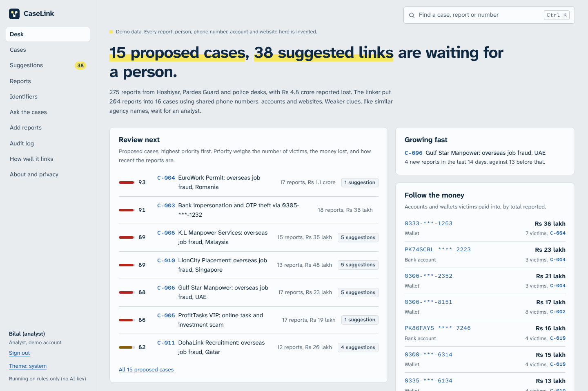
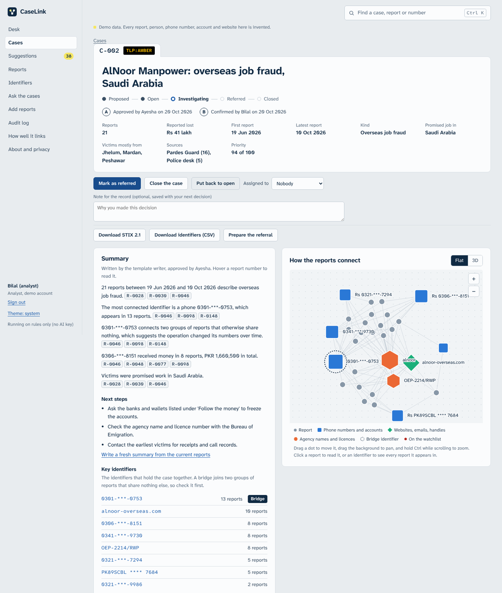
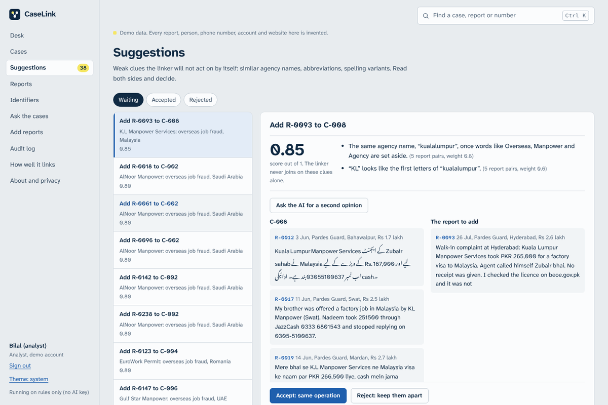
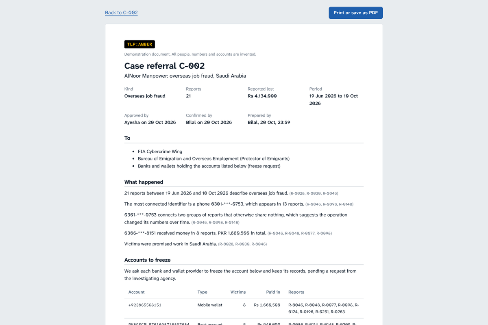
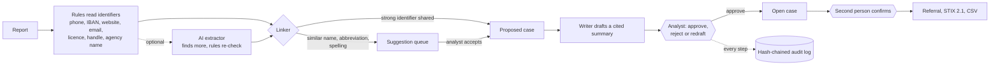

# CaseLink

A desk for fraud analysts. CaseLink reads complaints from several places, finds the phone numbers, bank accounts, websites and agency names in them, and joins the reports that share them into cases. Fifty victims of one fake overseas-job agency show up as one case with fifty reports, one money trail and one referral letter, instead of fifty separate files in three systems.

**The rule it is built on: AI suggests, rules and people decide.** Language models read, draft, translate and give second opinions. Joining reports is done by rules on hard evidence, and anything softer waits for an analyst.

The public demo runs on **synthetic data**: 275 invented reports from 12 invented fraud operations, plus 45 one-off reports, in English, Urdu and Roman Urdu. Every person, number, account and website in it is made up.



| Case file | Suggestion review | Referral |
|---|---|---|
|  |  |  |

## Where the reports come from

| Source | What it sends |
|---|---|
| **Hoshiyar** | The public scam checker (sister project). People paste suspicious SMS and WhatsApp messages; confirmed scam websites come over as a STIX 2.1 feed. |
| **Pardes Guard** | Overseas-job complaints: an agency took money for a visa or a job in the Gulf, Malaysia, Romania or Singapore. |
| **Police desks** | Walk-in complaints, often with no number at all. |

Reports can also be typed in, or uploaded as JSON, JSON lines, CSV or a STIX bundle.

## How a report becomes a case



1. **Identifiers are read by rules.** Phone and wallet numbers in any format (`+92 300…`, `0300-…`, `92300…`), IBANs with their checksum tested, websites written with or without `https`, or defanged (`site[.]com`), emails, emigration licence numbers, social handles, and agency names with the generic words (Overseas, Manpower, Agency) set aside. Official numbers and sites (FIA, the Bureau of Emigration, BISP) are recognised and never used to link. An optional AI pass looks for identifiers the rules missed; the rules check each one before it is kept.
2. **Strong links join automatically.** Two reports that share a phone number, account, website, email, licence or handle end up in the same proposed case. An identifier that appears in too many reports (more than 8%, at least 12) is treated as common and links nothing on its own.
3. **Weak links become suggestions.** The same agency name, an abbreviation (`KL Manpower` and `Kuala Lumpur Manpower`), or a one-letter spelling difference. Common names (Prime, Royal, Falcon…) score low. An analyst reads both sides, can ask the AI for a second opinion, and decides. Rejected pairs are remembered; reports a person placed by hand stay where they were put.
4. **A person reviews every case.** The writer agent drafts a summary in which each sentence cites the reports behind it; sentences that the cited reports do not support are removed. The LangGraph review graph then stops (`interrupt`) and waits for an analyst to approve, reject, or ask for a new draft. The paused state is checkpointed in Postgres, so a draft waiting for a decision survives a restart.
5. **Four eyes before anything leaves.** Someone other than the approver has to confirm a case before it can be referred or exported.
6. **Every action is in the audit log.** Agents and people alike. Each entry carries a SHA-256 hash of itself and of the entry before it, so a changed or deleted entry breaks the chain, and the app can check the whole chain on demand.

## What it can do

**The case file**
- Network graph of reports and the identifiers they share (flat, with drag, pan and zoom, or 3D). Bridges, the identifiers that hold two groups of reports together, are marked.
- Every report with its identifiers highlighted in the text, Urdu set in Nastaliq right to left, and a machine translation into English on request, labelled as such.
- **Follow the money**: each account and wallet victims paid into, with the number of victims and the total.
- Timeline of reports and losses, victims' cities, destination countries, languages.
- Case workflow: proposed, open, investigating, referred, closed, with notes, assignment and a priority score (victims, money lost, recency).
- Possibly related cases that share only a weaker clue, never joined automatically.
- Exports: a printable referral for the FIA Cybercrime Wing, the Bureau of Emigration and each bank or wallet (freeze requests), a STIX 2.1 bundle (TLP:AMBER), and a CSV of identifiers.

**Around the cases**
- The desk: what is waiting for a person, cases growing faster than usual, the accounts with the most money paid in, alerts.
- Watchlist: a watched identifier in a new report raises an alert. So does a report that reads almost the same as an earlier one, and a new report joining a case someone is already working on.
- **Ask the cases**: a tool-using assistant searches reports and cases and must cite them; any citation to something its tools never returned is removed.
- Search by wording or by identifier, however the number was written.
- Roles (viewer, analyst, supervisor) with one-click demo accounts, and a command palette (Ctrl K) to jump to any case, report or number.
- An **MCP server** with read-only tools, so an AI assistant such as Claude Desktop can query the cases without being able to change them.
- Daily digest to a Telegram channel, and a nightly reset of the public demo.

## How well it links

Measured against the synthetic data's hidden answer key, on pairs of reports (`python -m eval.run_eval`):

| | Precision | Recall | F1 |
|---|---|---|---|
| Rules alone | 100% | 71.2% | 83.2% |
| Rules + suggestions scoring 0.5 or more | 99.9% | 93.3% | 96.5% |

Of 38 suggestions, 31 point at reports from the same operation; the 7 wrong ones come from common agency names, which is why they score low and wait for a person. The rules found all 477 identifiers written into the reports, with no false ones. A CI gate fails the build if any of these drop below `eval/thresholds.json`.

These numbers come from synthetic data written by the same project, so real reports will be messier. They are a regression test, not a promise.

## Privacy and safety

- Phone numbers, IBANs and emails are replaced by tokens before any text is sent to a language model, and put back afterwards.
- Report text is passed to models as untrusted data; instructions inside a report are never followed.
- Models never decide links. A wrong join can point police at the wrong person, so the rules are tuned for precision and leave doubt to people.
- Lists show numbers part-hidden (`0301-***-0753`), as they would be on a shared screen.
- With `DEMO_MODE=false`, every page needs a login.

## Built with

- **Backend**: Python 3.12, FastAPI, SQLAlchemy (async), Postgres on Neon or SQLite locally, LangGraph 1.2 (review graph with `interrupt`, ingest graph, Postgres checkpointer), LangChain tool calling, the MCP Python SDK.
- **Models**: free tiers only. Groq (`openai/gpt-oss-120b`, `openai/gpt-oss-20b`) and Gemini as a fallback chain; a model that fails is parked for a while instead of retried. Without any key, everything still works on rules and templates.
- **Frontend**: React 19, TypeScript, Vite, d3-force for the graph, three.js for the 3D view, Atkinson Hyperlegible (designed so 0 and O, 1 and l never look alike, which matters when reading phone numbers and IBANs).
- **Hosting**: Render free web service and static site, Neon free Postgres, GitHub Actions for CI and scheduled jobs. Total cost: $0.

## Run it

```
cd backend
python -m venv .venv
.venv\Scripts\activate            # macOS/Linux: source .venv/bin/activate
pip install -r requirements-dev.txt
python run.py                      # http://127.0.0.1:8000

cd ../frontend
npm install
npm run dev                        # http://localhost:5173
```

No keys are needed to try it. [docs/SETUP.md](docs/SETUP.md) covers AI keys, Postgres, deploying to Render, GitHub Actions and the MCP server. [docs/HOSHIYAR.md](docs/HOSHIYAR.md) covers the link with Hoshiyar.

## Layout

```
backend/
  app/data/synthetic.py     the dataset generator and its hidden answer key
  app/extract/rules.py      identifier extraction
  app/link/                 linker (strong and weak edges, bridges) and case service
  app/agent/graphs.py       LangGraph review and ingest graphs
  app/ai/                   model chain, writer, adjudicator, translator, extractor, Q&A agent
  app/intel/                audit chain, STIX, search, quality scores
  app/api/                  HTTP routes
  app/mcp_server.py         read-only MCP server
  eval/                     evaluation and CI gate
  tests/
frontend/src/
  pages/                    desk, cases, case file, suggestions, reports, identifiers, ask, audit, add, quality
  components/               network graph (2D and 3D), charts, report text with highlights, command palette
```
