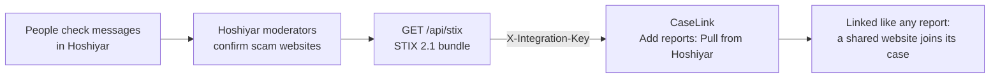

# CaseLink and Hoshiyar

Hoshiyar is the public side: people in Pakistan paste a suspicious message and learn whether it looks like a scam. Its moderators review what is shared and confirm scam websites. CaseLink is the analyst side: it joins reports into cases.

The two connect through STIX 2.1, the format threat-intelligence tools already use, so neither app depends on the other's database.

## Switch it on

1. **Hoshiyar's API** (Render, `hoshiyar-api`, Environment tab): `INTEGRATION_KEY` already exists if you deployed from Hoshiyar's Blueprint, because Render generated it. Copy its value. If it is not there, add it with a long random string (`python -c "import secrets; print(secrets.token_urlsafe(32))"`).
2. **CaseLink's API** (Render, `caselink-api`, Environment tab):
   - `HOSHIYAR_API_URL` = `https://hoshiyar-api.onrender.com`
   - `HOSHIYAR_INTEGRATION_KEY` = the same value as Hoshiyar's `INTEGRATION_KEY`
3. Save; both services redeploy. `https://caselink-api.onrender.com/api/health` now shows `"hoshiyar_link": true`.
4. In CaseLink, sign in as an analyst, open **Add reports**, and choose **Pull confirmed websites now**.

Hoshiyar's feed needs the Hoshiyar update that adds `GET /api/stix` (the partner feed). Without `INTEGRATION_KEY` set, Hoshiyar answers 404, so the feed is off unless you turn it on.

## What comes across

Only what Hoshiyar's moderators confirmed or a deterministic link check proved: scam websites, as STIX `indicator` objects with their campaign and first-seen date. Never the messages people pasted, never phone numbers, never anything about the person who checked.

Each indicator becomes one CaseLink report with source `hoshiyar` and channel `stix`. The linker then treats its website like any other identifier: if Pardes Guard or police reports mention the same site, the Hoshiyar report joins their case. If Hoshiyar is asleep on the free plan, the pull waits for it to wake (up to 90 seconds).

## Without the live link

Hoshiyar's admin panel can export a STIX bundle as a file. Upload it in CaseLink under **Add reports**, **Upload a file**; it goes through the same path.

## The other direction

CaseLink exports confirmed cases as STIX 2.1 too (per case, or all confirmed cases at once for a supervisor). Those bundles are for CERTs and police tools. They are not sent back to Hoshiyar automatically: what the public sees in Hoshiyar stays a decision for Hoshiyar's moderators.
